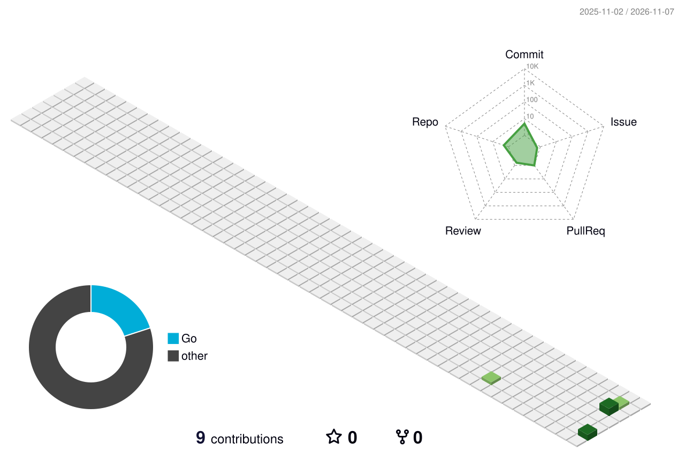

<div align="center" width="100%">

<!-- ANIMATED HEADER BANNER -->


<div dir="rtl">

### زیرساخت شبکه، VPN و اتوماسیون تلگرام

</div>

<!-- TYPING ANIMATION -->
[](https://git.io/typing-svg)

<br/>

<!-- PROFILE VIEWS + FOLLOWERS BADGES -->


</div>


##  دربارهٔ من

<div align="center">

```yaml
name        : Arshavin · آرشاوین
service     : L2TP/IPSec VPN Subscription Platform
network     : [ MikroTik, IBSng, WireGuard, GRE, NAT/PCQ ]
automation  : [ Telegram Bots, CRM, NOC Monitoring ]
stack       : [ Python, Rust, Go, Cloudflare Workers + D1 ]
status      : Always building something cool 🛠️
```

</div>

<div dir="rtl">

من زیرساخت یک سرویس اشتراک **L2TP/IPSec VPN** را طراحی، پیاده‌سازی و نگهداری می‌کنم: از روترهای MikroTik
و پنل حسابداری **IBSng** گرفته تا ربات فروش تلگرام، CRM دسکتاپ، سایت فروش و ابزارهای پایش شبکه.

کار روزمرهٔ من ترکیبی است از:

- **شبکه و سیستم:** RouterOS، L2TP/IPsec، GRE، WireGuard، NAT/PCQ، فایروال، سخت‌سازی سرور و تونل‌های پشتیبان
- **اتوماسیون:** ربات‌های فروش و پشتیبانی تلگرام، همگام‌سازی با IBSng، گزارش‌گیری مالی
- **مهندسی نرم‌افزار:** اپ‌های دسکتاپ (Python / CustomTkinter)، سرویس‌های Rust و Go، پلتفرم‌های وب روی Cloudflare Workers + D1
- **داده و کیفیت:** SQLite/SQLAlchemy، تست‌های بدون شبکه (offline harness)، CI/CD روی GitHub Actions

> همهٔ مخازن خصوصی‌اند و کد اختصاصی است؛ استفادهٔ مجدد تنها با اجازهٔ نویسنده.

</div>

> *"Code is poetry — write it beautifully."*


##  پروژه‌های شاخص

<div dir="rtl">

| پروژه | توضیح | استک |
|---|---|---|
| **[Mikrotik-Bot](https://github.com/my-vpn-bot/Mikrotik-Bot)** | ربات فروش/تمدید اشتراک VPN با استعلام زندهٔ وضعیت کاربر از IBSng | Python · aiogram |
| **[VPN_Tool_2](https://github.com/my-vpn-bot/VPN_Tool_2)** | سامانهٔ صدور اشتراک + CRM دسکتاپ (کارت اشتراک، داشبورد فروش، تحویل خودکار در PV) | Python · CustomTkinter |
| **[arshavin-monitor](https://github.com/my-vpn-bot/arshavin-monitor)** | مرکز کنترل NOC: پایش ناوگان روتر/IBSng، موتور تشخیص رخداد، جدول نشست‌های زنده | Rust · Slint |
| **[vpn-platform](https://github.com/my-vpn-bot/vpn-platform)** | پلتفرم تجارت VPN با معماری API-First: سایت SSR، پنل ادمین، REST API | Workers · D1 |
| **[eblagh-assistant](https://github.com/my-vpn-bot/eblagh-assistant)** | مدیر ابلاغیه‌های قضایی با محاسبهٔ خودکار مهلت اعتراض و لایحه‌نویسی با AI | FastAPI · DDD |
| **[arshavin-telegram-crm](https://github.com/my-vpn-bot/arshavin-telegram-crm)** | ارسال انبوه و CRM تلگرام با پاسخ هوشمند و گارد نشت اطلاعات | Python · Telethon |
| **[telegram-sender-cli](https://github.com/my-vpn-bot/telegram-sender-cli)** | نسخهٔ خط فرمان همان سامانه برای سرور لینوکس | Rust · Telethon bridge |
| **[adbot-go](https://github.com/my-vpn-bot/adbot-go)** | ربات زمان‌بندی تبلیغات کانال تلگرام با داشبورد وب | Go · SQLite |
| **[exam-platform](https://github.com/my-vpn-bot/exam-platform)** | سامانهٔ آزمون با ایزوله‌سازی نشست و کارنامهٔ والدین در تلگرام/SMS | Workers + D1 · Node |
| **[website-vpn](https://github.com/my-vpn-bot/website-vpn)** | لندینگ فروش سرویس، تک‌فایل روی Cloudflare Worker | JavaScript |
| **[ibsng-online](https://github.com/my-vpn-bot/ibsng-online)** · **[ibs-online-monitor](https://github.com/my-vpn-bot/ibs-online-monitor)** · **[ibsng-cap-guard](https://github.com/my-vpn-bot/ibsng-cap-guard)** | ابزارهای عملیاتی IBSng: نمایش/قطع نشست آنلاین، پایش تمام‌صفحه، کنترل سقف حجم | Python |
| **[aylin-learn](https://github.com/my-vpn-bot/aylin-learn)** · **[aylin-studio-app](https://github.com/my-vpn-bot/aylin-studio-app)** | استودیوی یادگیری پایهٔ هشتم (۲۶۰۰+ سؤال، لایتنر، آزمون زمان‌دار، آفلاین) | Astro · PWA |
| **[ghasedak-platform](https://github.com/my-vpn-bot/ghasedak-platform)** · **[ghasedak-astro](https://github.com/my-vpn-bot/ghasedak-astro)** · **[ghasedak](https://github.com/my-vpn-bot/ghasedak)** | فروشگاه و ویترین «اکسسوری اروم قاصدک» (باسلام) | Astro · Workers · D1 |
| **[ghasedak-assistant](https://github.com/my-vpn-bot/ghasedak-assistant)** | دستیار نیمه‌خودکار غرفه: پیش‌نویس پاسخ چت، سینک قیمت، تبلیغ تلگرام | Python |

<details>
<summary><b>نقشهٔ فنی مخازن (کلیک کنید)</b></summary>

<br>

```
اپلیکیشن‌های مشتری
├── تلگرام      Mikrotik-Bot · arshavin-telegram-crm · telegram-sender-cli · adbot-go
├── دسکتاپ      VPN_Tool_2 · vpn-tool · arshavin-monitor · ibs-online-monitor
├── وب           vpn-platform · website-vpn · vpnweb · exam-platform
└── فروشگاه      ghasedak-platform · ghasedak-astro · ghasedak

عملیات و زیرساخت
├── IBSng       ibsng-online · ibsng-cap-guard · ibs-online-monitor
├── پایش         arshavin-monitor
└── CI/CD       GitHub Actions (build · test · release) در تمام مخازن
```

</details>

</div>


##  پشتهٔ فنی

<div align="center">

<div dir="rtl">

| # | دسته | آیکون‌ها |
|---|---|---|
| 🔤 | **زبان‌ها** | [](#) |
| ⚙️ | **بک‌اند** | [](#) |
| 🎨 | **فرانت** | [](#) |
| 🚀 | **DevOps** | [](#) |
| 🧰 | **ابزارها** | [](#) |

</div>

<p>
  
  
  
  
  
  
</p>

</div>

<div dir="rtl">

| لایه | ابزارها |
|---|---|
| شبکه | MikroTik RouterOS · L2TP/IPsec · GRE · WireGuard · PCQ/NAT · nginx |
| حسابداری کاربر | IBSng (استعلام زنده، سقف حجم، نشست‌های آنلاین) |
| بک‌اند | Python (FastAPI, aiogram, Telethon) · Node.js · Cloudflare Workers · Rust · Go |
| داده | SQLite · SQLAlchemy + Alembic · Cloudflare D1 |
| فرانت | Astro · TypeScript · Tailwind · PWA (service worker, offline-first) |
| اپ دسکتاپ | CustomTkinter (RTL) · Slint · PyInstaller |
| کیفیت | pytest · node:test · vitest · cargo test · go test · GitHub Actions |
| سرور | Ubuntu · Docker Compose · systemd · Cloudflare DNS |

</div>


##  GitHub Stats

<div align="center">

[](https://git.io/streak-stats)


</div>


##  3D Contribution Map

<div align="center">

<picture>
  <source media="(prefers-color-scheme: dark)" srcset="./profile-3d-contrib/profile-night-green.svg" />
  
</picture>

</div>


##  Contribution Graph

<div align="center">

[](https://github.com/ashutosh00710/github-readme-activity-graph)

</div>


##  Contributions

<div align="center">

<picture>
  <source media="(prefers-color-scheme: dark)" srcset="https://raw.githubusercontent.com/my-vpn-bot/my-vpn-bot/output-pacman/pacman-contribution-graph-dark.svg">
  <source media="(prefers-color-scheme: light)" srcset="https://raw.githubusercontent.com/my-vpn-bot/my-vpn-bot/output-pacman/pacman-contribution-graph.svg">
  
</picture>

</div>


##  Snake Eating My Contributions

<div align="center">

<picture>
  <source media="(prefers-color-scheme: dark)" srcset="https://raw.githubusercontent.com/my-vpn-bot/my-vpn-bot/output/github-contribution-grid-snake-dark.svg">
  <source media="(prefers-color-scheme: light)" srcset="https://raw.githubusercontent.com/my-vpn-bot/my-vpn-bot/output/github-contribution-grid-snake.svg">
  
</picture>

</div>


##  اصول کاری

<div dir="rtl">

1. **اول تست، بعد انتشار** — هر مخزن یک workflow تست دارد و انتشار فقط از روی تگ `v*` انجام می‌شود.
2. **رازها هرگز در گیت نیستند** — توکن‌ها و رمزها در فایل‌های محلی/Secret می‌مانند و فقط نمونهٔ `.example` منتشر می‌شود.
3. **تغییرات مخرب، اول dry-run** — ابزارهای عملیاتی (مثل کنترل سقف حجم) با حالت پیش‌نمایش و لاگ حسابرسی کار می‌کنند.
4. **مستندسازی فارسی و راست‌به‌چپ** — README هر پروژه، راه‌اندازی و عیب‌یابی را کامل توضیح می‌دهد.

</div>


##  تماس

<div align="center">

<div dir="rtl">

- ربات سرویس · پشتیبانی · کانال اطلاع‌رسانی

</div>

[](https://t.me/L2TP_Arshavin_Bot)
[](https://t.me/L2tp1Support)
[](https://t.me/L2tp_vpn402)

</div>


<div align="center">

<!-- FOOTER WAVE -->


**⭐ If you like what you see, consider starring some repos!**

</div>
